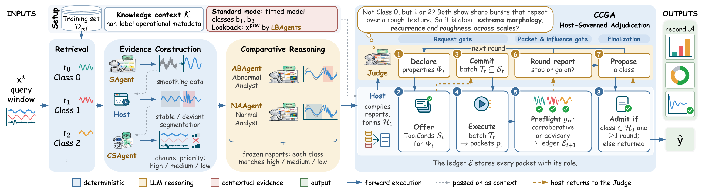
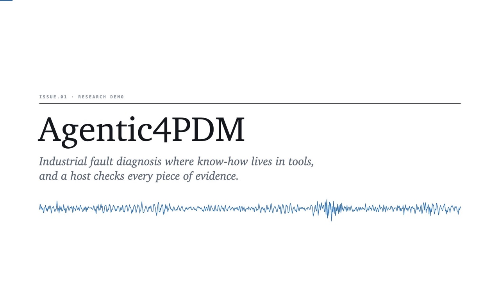
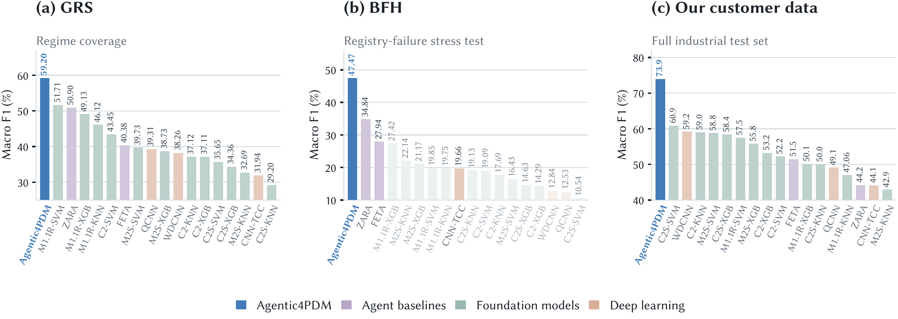

<div align="center">

# Agentic4PDM

### Host-Governed Evidence Admissibility for Industrial Fault Diagnosis

[](https://arxiv.org/abs/2610.17786)
[](https://david-nguyen-s16.github.io/agentic4pdm_homepage/)
[](https://david-nguyen-s16.github.io/agentic4pdm_homepage/#demo)
[](#-code-release)

Nam V. Nguyen<sup>1</sup> · Hoang Van Truong<sup>1</sup> · Hieu D. D.<sup>1</sup> · Duy Khuong Nguyen<sup>1</sup> · Quang Pham<sup>2</sup> · Tung Kieu<sup>3</sup>

<sup>1</sup>FPT Corporation &nbsp;·&nbsp; <sup>2</sup>Independent Researcher &nbsp;·&nbsp; <sup>3</sup>Aalborg University

</div>

---

## 📢 Code release

> [!IMPORTANT]
> **Code coming soon.** We plan to release the code in this repository on **16 October 2026**.
> Star or watch the repository to get a notification when it is out.

## 📰 News

- **2026-10-14** — The project page and a 3-minute demo video are online.
- **2026-10-13** — The paper is available on arXiv: [arXiv:2610.17786](https://arxiv.org/abs/2610.17786).

## Overview

When a diagnosis remains ambiguous, what should an agent investigate, and how much should each result influence its decision?

Agentic4PDM treats industrial fault diagnosis as a classification task: it assigns each sensor time-series sample to a predefined health state or fault type. It separates **adaptive investigation** from **control over evidence use**:

- **LLM agents investigate.** They compare each signal with labeled references from every candidate class, name the distinctions that are still unresolved, and propose follow-up measurements with analytical tools.
- **A deterministic host governs.** It enforces *contract-checked gated adjudication* (CCGA): it checks requests, asks the agent to commit to a complete tool batch before seeing any results, and assigns each result an evidence role based on tool checks against labeled references.

<p align="center">
  
</p>

CCGA has three gates:

| Gate | What the host checks |
| --- | --- |
| **1. Request gate** | The Judge declares the unresolved signal properties, receives compatible tools (ToolCards), commits to a complete batch, and then executes it. The host checks coverage and blocks repeated measurements of the same property. |
| **2. Packet & influence gate** | Each tool is first tested on known-label controls. If every control is recovered, the result is **corroborative** evidence; otherwise it is **advisory** information. Failed or ambiguous packets are excluded. |
| **3. Finalization** | A proposed class is admitted only if it was in the initial candidate set and at least one round of measurements is complete. Otherwise, the proposal goes back for revision within the step budget. |

Agentic4PDM runs in two modes:

- **Standard mode** uses pretrained embeddings and labeled references, plus SVM and XGBoost predictions, which it treats as hypotheses to investigate. The main results use this mode.
- **Training-free mode** uses pretrained representations and labeled references, with no task-specific fitted diagnostic classifier.

## 🎬 Demo

<p align="center">
  <a href="https://david-nguyen-s16.github.io/agentic4pdm_homepage/#demo">
    
  </a>
  <br>
  <em>A 3-minute narrated overview: the problem, the idea, how the agent reaches a decision under CCGA, and the results.<br>Click the image to watch it on the project page.</em>
</p>

## 📊 Results

Agentic4PDM reaches the highest aggregate macro-F1 among the evaluated diagnostic and agentic methods on all three tests (standard mode, Qwen3.6-27B for all agentic methods).

| Test | What it measures | Agentic4PDM macro-F1 (%) | Best baseline (%) |
| --- | --- | :---: | :---: |
| **GRS** | Regime coverage, average over the public datasets (MCC5, PU, UO) | **59.20** | 51.71 (M1.1R-SVM) |
| **BFH** | Hard cases where many baseline models fail, average over the public datasets | **47.47** | 34.84 (ZARA) |
| **Customer test (Bel)** | All 330 samples of an unfiltered industrial test set from our customer | **73.95** | 60.9 (C2S-SVM) |

<p align="center">
  
</p>

See the [paper](https://arxiv.org/abs/2610.17786) and the [project page](https://david-nguyen-s16.github.io/agentic4pdm_homepage/) for the full results, ablations, and analysis.

## 📝 Citation

If you find this work useful, please cite:

```bibtex
@misc{nguyen2026agentic4pdmhostgovernedevidenceadmissibility,
      title={Agentic4PDM: Host-Governed Evidence Admissibility for Industrial Fault Diagnosis}, 
      author={Nam V. Nguyen and Hoang Van Truong and Hieu D. D. and Duy Khuong Nguyen and Quang Pham and Tung Kieu},
      year={2026},
      eprint={2610.17786},
      archivePrefix={arXiv},
      primaryClass={cs.AI},
      url={https://arxiv.org/abs/2610.17786}, 
}
```

## Contact

For questions, please open an issue or contact the corresponding author, Nam V. Nguyen (namnguyen16ai@gmail.com).
